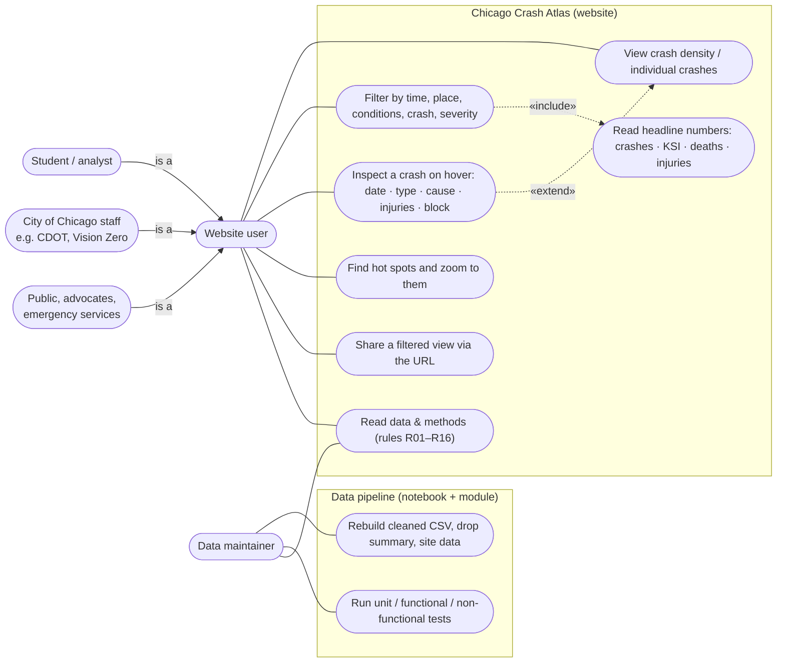
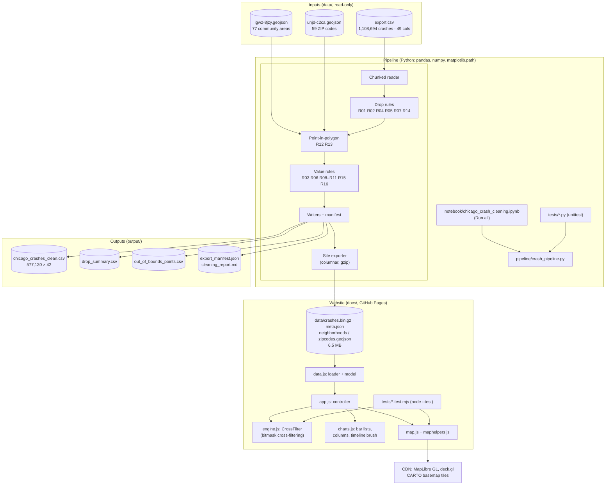
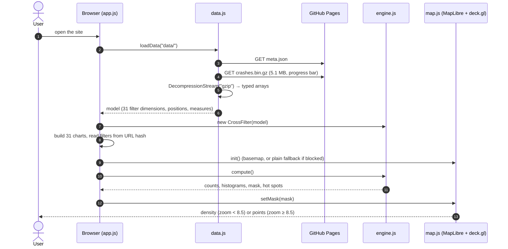
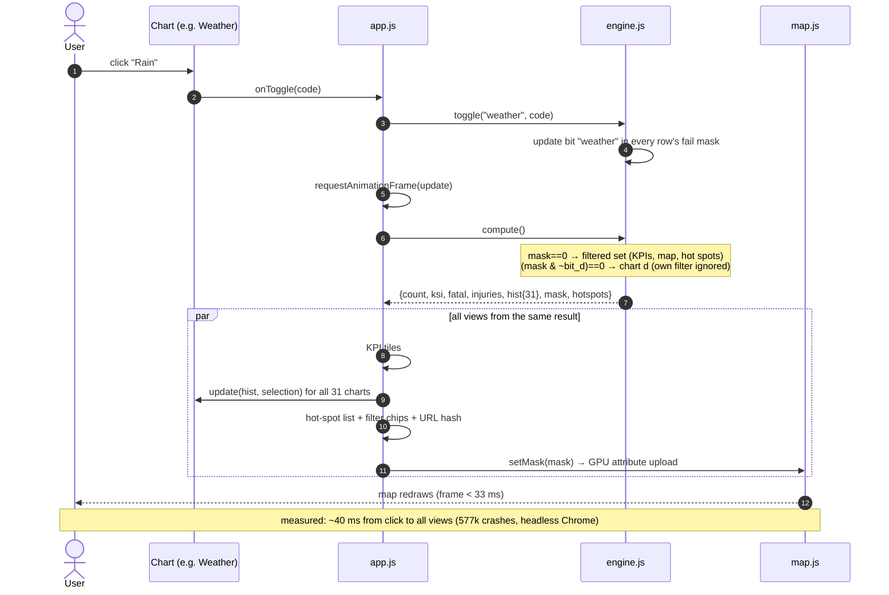

# System architecture

Three diagrams, written in Mermaid (GitHub renders them directly). PNG copies are in `design/`.

## 1. Use case diagram

## 2. Component diagram

## 3. Sequence diagrams

### 3a. Loading the site

### 3b. Changing a filter (FR-2, FR-4, NFR-1/3)

